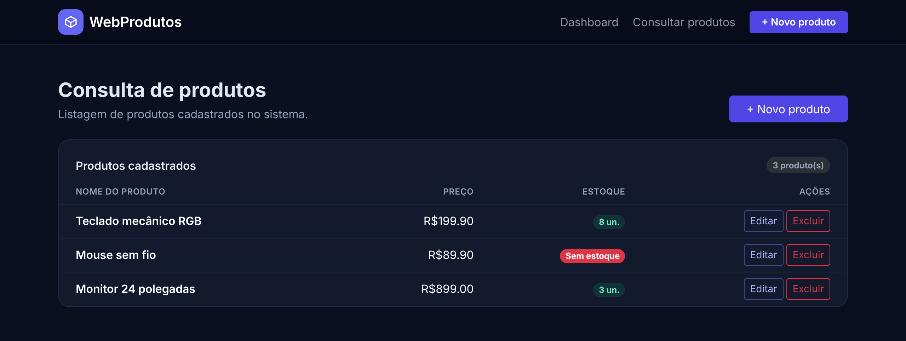
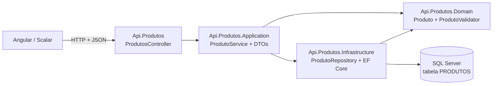

# Api.Produtos

API REST para o cadastro de produtos, construída com **ASP.NET Core (.NET 10)** em arquitetura **DDD**, com **Entity Framework Core**, **SQL Server** e documentação interativa com **Scalar**.

Projeto desenvolvido para a **Lista de Exercícios 01 – ASP.NET Core API / Angular** do curso **C#.NET WebDeveloper (Formação Fullstack)** da COTI Informática.

O front-end que consome esta API está no repositório **[WebProdutos](https://github.com/Mnovis/WebProdutos)**.



---

## Arquitetura

A solução segue o DDD (Domain-Driven Design): a **API** é a camada de serviços (Services Layer), e as três bibliotecas de classes da pasta `DDD` formam a camada de dados (Data Layer).



| Projeto                       | Responsabilidade                                                                          |
| ----------------------------- | ----------------------------------------------------------------------------------------- |
| `Api.Produtos`                | Controller REST, documentação Scalar e política de CORS                                   |
| `Api.Produtos.Application`    | Orquestra os casos de uso (`ProdutoService`) e define os DTOs de entrada e saída          |
| `Api.Produtos.Domain`         | Entidade `Produto` e regras de validação com FluentValidation                             |
| `Api.Produtos.Infrastructure` | Acesso ao banco com Entity Framework: mapeamento, `DataContext`, migrations e repositório |

---

## Endpoints

Base: `http://localhost:5052/api/v1/produtos`

| Método   | Rota                    | Descrição                              | Respostas          |
| -------- | ----------------------- | -------------------------------------- | ------------------ |
| `POST`   | `/api/v1/produtos`      | Cadastra um produto                    | 201, 400, 500      |
| `PUT`    | `/api/v1/produtos/{id}` | Atualiza um produto                    | 200, 400, 404, 500 |
| `DELETE` | `/api/v1/produtos/{id}` | Exclui um produto                      | 200, 404, 500      |
| `GET`    | `/api/v1/produtos`      | Lista os produtos, ordenados pelo nome | 200, 500           |
| `GET`    | `/api/v1/produtos/{id}` | Busca um produto pelo id               | 200, 404, 500      |

**Exemplo de requisição (POST e PUT):**

```json
{
  "nome": "Teclado mecânico",
  "preco": 150.9,
  "quantidade": 10
}
```

**Exemplo de resposta:**

```json
{
  "idProduto": "3fa85f64-5717-4562-b3fc-2c963f66afa6",
  "nome": "Teclado mecânico",
  "preco": 150.9,
  "quantidade": 10
}
```

### Regras de validação

| Campo        | Regra                                                 |
| ------------ | ----------------------------------------------------- |
| `nome`       | Obrigatório, entre 6 e 50 caracteres e único no banco |
| `preco`      | Maior que zero                                        |
| `quantidade` | Maior ou igual a zero                                 |

Erros de validação retornam **400** com a lista de mensagens. Um produto inexistente retorna **404**.

---

## Tecnologias

- .NET 10 / ASP.NET Core Web API
- Entity Framework Core 10 (Code First com Migrations)
- SQL Server 2022 em Docker
- FluentValidation 12
- Scalar 3 (documentação da API)

---
